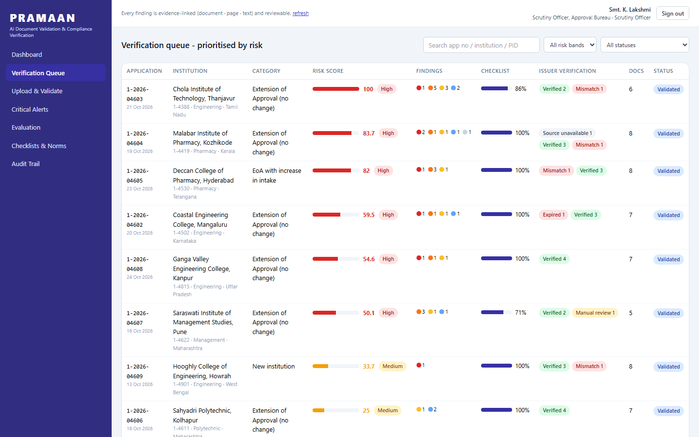
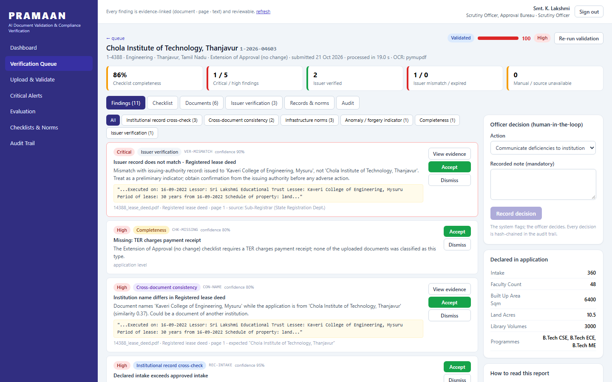
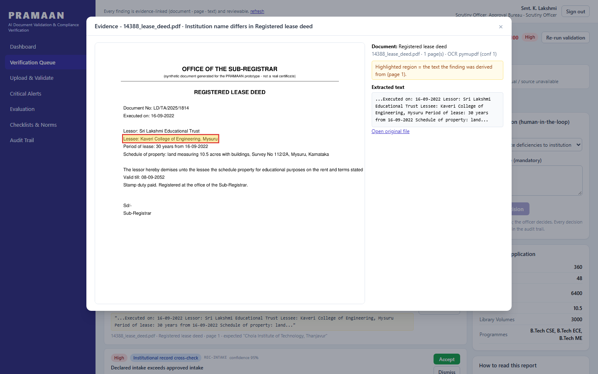
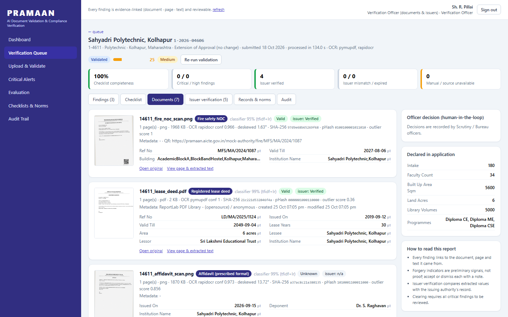

# PRAMAAN

Prototype for Smart India Hackathon 2026, problem statement **SIH26261** (AICTE):
*AI-Powered Application Validation, Document Authentication and Regulatory Compliance Verification*.

Every approval application to AICTE comes with a bundle of supporting documents: fire NOC, lease deed,
structural certificate, affidavit, faculty list, fee receipt, university affiliation and so on. Someone has
to check that each one is there, is the right document, has not expired, matches what the institution
declared and what AICTE already has on record, and is not another college's certificate with the name
changed. Done by hand across thousands of applications this is slow and uneven, and the altered ones are the
hardest to catch.

PRAMAAN does the first pass. It reads the documents, pulls out the facts that matter, checks them against the
checklist, the application and the institution's record, asks the issuing authority where that is possible,
and hands the officer a list of findings, each pointing at the page and line it came from.

## What it does

- **Reads both digital and scanned documents.** PDFs through their text layer; scans and photos through OCR
  (RapidOCR, runs offline) after OpenCV straightens and cleans the image.
- **Recognises the document type** (TF-IDF + logistic regression over twelve AICTE document types) and
  **extracts fields**: reference number, issue and expiry dates, institution name, areas, amounts, keeping
  the page and bounding box of each value.
- **Checks completeness** against a configurable checklist: missing, expired, too old, uploaded under the
  wrong head, unreadable.
- **Cross-checks** names and identifiers across documents, declared figures against institutional records,
  and built-up area, land and faculty strength against infrastructure norms.
- **Looks for tampering**: PDF metadata (image editors, modification before creation, edits after signing),
  impossible date sequences, error-level analysis on scans, identical or near-identical files across
  institutions (SHA-256 and perceptual hash), and an Isolation Forest outlier score.
- **Verifies with the issuer** over API, QR code or digital signature where one exists (here against a
  mock registry) and reports verified, mismatch, expired, source unavailable or manual review.
- **Ranks applications by risk** and lets officers accept or dismiss each finding (dismissing needs a
  reason), then record a decision. Clearing is blocked while critical findings are unreviewed. Every action
  goes into a hash-chained audit log.

Forgery indicators are signals for a person to check, not verdicts. The system never rejects anything on
its own.

## Running it

Python 3.11 or newer. No system packages; the OCR models come with the `rapidocr-onnxruntime` wheel.

```
pip install -r requirements.txt
python -m uvicorn app.main:app --port 8061
```

The first start takes two or three minutes: it generates the synthetic corpus (10 applications, about 70
documents) and runs the whole pipeline over it. Then open http://127.0.0.1:8061. API docs at `/docs`;
`python tests/smoke.py` runs an end-to-end check that includes a live upload.

Environment variables: `DATABASE_URL` (PostgreSQL instead of SQLite), `PRAMAAN_JWT_SECRET`.

## Demo accounts

Password `demo123` for all: `scrutiny` (Scrutiny Officer), `verifier` (Verification Officer), `bureau`,
`admin`, and the institutions `inst.nalanda` and `inst.coastal`. `/?demo=scrutiny#/queue` signs in and
opens the queue. Institutions see only the findings they can fix (missing, expired, inconsistent); the
forensic and issuer-verification detail is for officers.

## The planted problems

The seed corpus is fictional and deliberately broken in known ways so that every check can be seen firing:
an expired fire NOC; a lease deed in another college's name; declared intake above the approved figure
while the fee shows as unpaid; the same NBA certificate submitted by two institutions; a fire NOC saved from
Photoshop with its validity pushed out a year (the issuer's record disagrees); a skewed phone scan with a QR
code; an issuing authority whose service is down; missing documents and a reference the university does not
recognise; a structural certificate that expires before it was issued; a receipt uploaded as a faculty list;
a bank FDR whose amount the bank does not confirm.

The **Evaluation** page scores the pipeline against this ground truth. On the current corpus it finds all 21
planted problems and raises no high-severity forgery flag on the clean documents. Those are numbers on
synthetic data, not a claim about real AICTE paperwork.

## Layout

```
app/
  ocr.py             engine chain, deskew, page rendering with highlights, QR decoding
  classify.py        document-type classifier
  extract.py         field extraction with page and bounding-box evidence
  forensics.py       hashing, metadata and date checks, ELA, outlier scoring
  verify.py          issuer verification; mock_authority.py stands in for the real registries
  pipeline.py        per-document processing, application validation, risk score
  docgen.py, seed.py synthetic corpus
  api.py, main.py
rules/checklists.json  required documents per application type and norms (illustrative values)
frontend/              React 18 + Tailwind as plain scripts (no build step); libraries are vendored
tests/                 smoke.py, revalidate.py
screenshots/
```

## Screenshots








